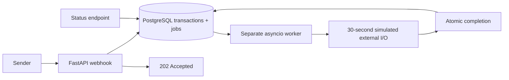

# Walnut Transactions API

A Python service that acknowledges transaction webhooks immediately and processes them
reliably in the background. Built for the Walnut Folks backend assessment.

**Stack:** FastAPI · PostgreSQL · psycopg 3 · asyncio worker · pytest

## Public demo

- API health: https://walnut-transactions-free.onrender.com/
- Interactive API docs: https://walnut-transactions-free.onrender.com/docs

Free Render hosting sleeps after inactivity; open the health URL and allow the instance
about a minute to wake before testing. The first request can exceed 500 ms. The free
database expires on **22 November 2026**. See hosting limits below.

## Try the running local service

Open **http://127.0.0.1:8000/docs** for interactive API documentation.

1. Expand `POST /v1/webhooks/transactions` and select **Try it out**.
2. Send the example below with a fresh `transaction_id`.
3. Expect `202 Accepted`; the `X-Response-Time-Ms` header reports server response time.
4. Query `GET /v1/transactions/{transaction_id}` immediately: `PROCESSING`.
5. Query again after about 30 seconds: `PROCESSED`, with `processed_at` populated.
6. Resend the identical webhook: `202`, `duplicate: true`, with no new job.

```json
{
  "transaction_id": "txn_try_001",
  "source_account": "acc_user_789",
  "destination_account": "acc_merchant_456",
  "amount": 1500,
  "currency": "INR"
}
```

Or run a complete demo (requires the development dependencies):

```sh
uv run python scripts/demo.py
# Against a deployed API:
uv run python scripts/demo.py --base-url https://YOUR-SERVICE-URL
```

## Local setup without Docker

Requirements: Python 3.12+, [uv](https://docs.astral.sh/uv/getting-started/installation/),
and PostgreSQL 17 binaries. On macOS, `brew install postgresql@17` installs the database.

From the repository directory:

```sh
uv sync --frozen --extra dev
cp .env.example .env
uv run python scripts/local.py start
```

The launcher initializes a project-owned PostgreSQL cluster in `.local/postgres`, creates
the database, applies migrations, and starts the API and worker as independent processes.
It binds the API to `127.0.0.1:8000` and PostgreSQL to `127.0.0.1:55432`.
No system database service is started. Local-only trust authentication is used for this
isolated developer cluster; cloud deployments must use database credentials and TLS.

```sh
uv run python scripts/local.py status
uv run python scripts/local.py restart-worker
uv run python scripts/local.py stop
```

Stopping preserves the database. Starting again preserves existing transactions and jobs.
Logs: `.local/api.log`, `.local/worker.log`, `.local/postgres.log`.
If PostgreSQL is installed elsewhere, set `POSTGRES_BIN_DIR` to its `bin` directory.
If `DATABASE_URL` points to another PostgreSQL instance, the launcher uses that database.

## Docker Compose alternative

```sh
docker compose up --build -d
docker compose logs -f api worker
docker compose down
```

Compose starts PostgreSQL, a one-time migration service, the API, and a worker.
The database uses a named volume, so `down` preserves records. Do not run the native
launcher and Compose simultaneously: they use the same ports.

## API

### `GET /`

Returns `200` when the transaction table is accessible. An unavailable database or missing
migration returns `503` with `status: UNHEALTHY`.

```json
{"status":"HEALTHY","current_time":"2026-10-23T10:30:00Z"}
```

### `POST /v1/webhooks/transactions`

```sh
curl -i http://127.0.0.1:8000/v1/webhooks/transactions \
  -H 'Content-Type: application/json' \
  -d '{"transaction_id":"txn_curl_001","source_account":"acc_user_789","destination_account":"acc_merchant_456","amount":1500,"currency":"INR"}'
```

```json
{"transaction_id":"txn_curl_001","status":"ACCEPTED","duplicate":false}
```

- New or identical duplicate: `202 Accepted` (duplicate requests set `duplicate: true`).
- Same ID with different details: `409 Conflict`; the original record is preserved.
- Invalid payload: `422 Unprocessable Entity`.
- Storage unavailable or acknowledgment deadline exceeded: `503` with `Retry-After: 1`.
  Retry the identical request with the same ID. The API never knowingly acknowledges
  work that has not been committed. A connection failure during commit can leave its
  outcome uncertain; retrying is safe because acceptance is idempotent.

### `GET /v1/transactions/{transaction_id}`

```sh
curl http://127.0.0.1:8000/v1/transactions/txn_curl_001
```

The single-item array deliberately matches the assessment's example:

```json
[
  {
    "transaction_id": "txn_curl_001",
    "source_account": "acc_user_789",
    "destination_account": "acc_merchant_456",
    "amount": 1500.00,
    "currency": "INR",
    "status": "PROCESSED",
    "created_at": "2026-10-23T10:30:00Z",
    "processed_at": "2026-10-23T10:30:30Z"
  }
]
```

During processing, `status` is `PROCESSING` and `processed_at` is `null`.
Unknown IDs return `404`; unavailable storage returns `503`.

## Architecture and technical choices



**Fast acknowledgment.** Validation and a short database transaction are the only work
in the webhook endpoint. Connections are pooled. A 400 ms storage deadline leaves
headroom beneath the 500 ms target. Actual network response time depends on deployment,
load, and region; the target must be measured on the deployed service as well.

**Atomic acceptance.** The transaction and its durable job are inserted in one commit.
There is no gap between saving a transaction and publishing work to another service.
`transaction_id` is the primary key in both tables. Concurrent duplicates use
`ON CONFLICT DO NOTHING` and compare against the original payload.

**Durable background work.** A database-backed queue avoids adding Redis or a broker for
this small workload. The worker claims rows with `FOR UPDATE SKIP LOCKED`, records a
unique lease token, and releases the database connection before the simulated work.
Twenty concurrent slots handle slow I/O independently of the API.

**Recovery and retries.** Workers renew leases while processing. A hard crash leaves a
recoverable job whose lease expires after at most 60 seconds from its last heartbeat.
A replacement worker retries it, including a new 30-second delay. Graceful shutdown
releases jobs immediately. Transient failures retry with exponential backoff capped at
60 seconds. Jobs are never discarded after a fixed attempt limit. Attempts and the most
recent failure are stored in `jobs` and events are logged.

**Safe completion.** Updating the job and transaction is atomic. Only the current,
unexpired lease token may commit completion; stale workers cannot overwrite a newer
attempt. This provides one stored transaction and final result. Work execution is
at least once across crashes, not a claim of exactly-once external side effects. A real
payment integration must also pass an idempotency key to the external provider.

**Money and time.** Numeric JSON amounts are parsed directly into Python `Decimal`,
stored as PostgreSQL `numeric(18,2)`, and serialized directly back to JSON numbers.
This avoids a float round-trip at both the request and response boundaries.
The supplied amount is stored in the same unit
as received; no paise/rupee conversion is assumed. Amounts must be positive with at most
two decimal places. Currency is normalized to three uppercase letters (not checked
against an ISO registry). UTC timestamps come from PostgreSQL for transaction events.

## Tests

Start the local service/database first, then:

```sh
uv run ruff check .
uv run ruff format --check .
uv run python -m pytest -v -s
# Faster development checks, excluding the real 30-second scenario:
uv run python -m pytest -v -m 'not slow'
```

Tests use real PostgreSQL and an isolated random schema per test, leaving the running
application's records untouched. Override `TEST_DATABASE_URL` to use a separate test
database. GitHub Actions provisions PostgreSQL and runs the entire suite.

Coverage includes concurrent duplicates, duplicate delivery after completion, real
30-second processing, acknowledgment timing under concurrent load, atomic rollback,
concurrent claims, lease renewal, crash recovery, stale-worker fencing, failure retries,
validation, exact decimal serialization, and missing-storage responses.

Additional regression tests verify exact numeric JSON input, non-finite number rejection,
lock contention with safe retries, and rollback of a partially attempted completion.

### Reproduce the HTTP benchmark

```sh
uv run python scripts/benchmark.py --output .local/benchmark.json
# Against the deployed API, from the machine used for testing:
uv run python scripts/benchmark.py --base-url https://YOUR-SERVICE-URL --output .local/cloud-benchmark.json
```

The default run sends 20 unique transactions and 40 duplicate deliveries, with at most
20 HTTP requests in flight. It reports client-observed p50/p95/p99 and maximum latency,
waits for all 20 final results, and verifies the minimum 30-second processing delay.
It exits nonzero on failed acknowledgments, missed latency targets, or incomplete work.
See [verification evidence](docs/verification.md) for measured results and their scope.

## Free cloud deployment

The [Render Blueprint](render.yaml) runs the API and worker as separate supervised
processes in one free web container, with private-network free PostgreSQL in Singapore.
`python -m app.service` applies migrations before starting both processes. If either
process exits unexpectedly, the supervisor stops its sibling and exits nonzero so Render
can restart the service. Docker Compose and local development retain separate services.

This is a free interview demo, with explicit hosting limits:

- Render sleeps the web service after 15 minutes without incoming traffic. The first
  request can take about a minute and exceeds the assignment's 500 ms target.
- The worker pauses while the container sleeps; durable pending jobs resume on wake.
- Free PostgreSQL expires after 30 days (this instance: 22 November 2026). Export or
  upgrade before expiry to preserve data. There are no free database backups.
- Free instance hours are shared across the workspace. This is not an always-on SLA.

Warm API latency is measured separately from wake-up time. Predictable first-request
latency and continuous background processing require always-on hosting. Automatic
redeploys wait for GitHub checks to pass. Applying the Blueprint creates only free plans.

For a provider-neutral deployment:

1. Provision cloud PostgreSQL and give both services its credentialed `DATABASE_URL`.
2. Build both services with `uv sync --frozen --no-dev`.
3. Run the release command once: `uv run python -m app.migrate`.
4. Web command: `uv run uvicorn app.main:app --host 0.0.0.0 --port "$PORT"`.
5. Worker command: `uv run python -m app.worker`.
6. Keep the web service and worker running, and place both close to the database.
7. Verify the public health check, run the demo against the public URL, and measure latency.

Use always-on hosting for predictable response times. The free demo intentionally
trades that guarantee for zero hosting cost; the durable queue design remains the same.

## Scope

Processing is the specified 30-second simulation followed by persistence. No real money
moves. Provider signature verification, authentication, rate limiting, and queue alerting
would be added for an actual payment integration; they are outside the supplied contract.
